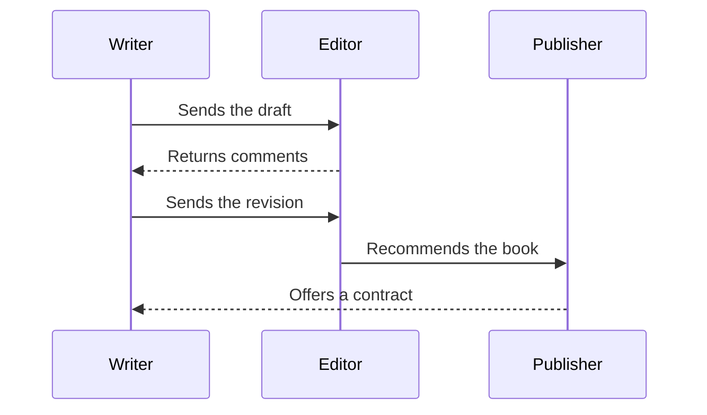
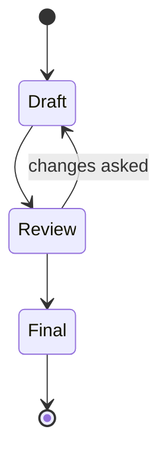
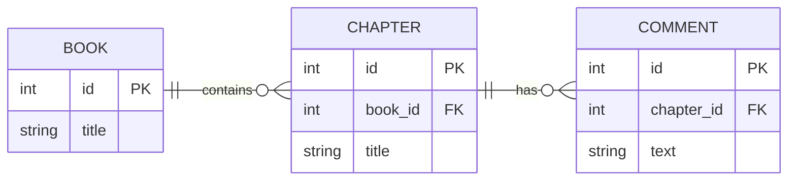
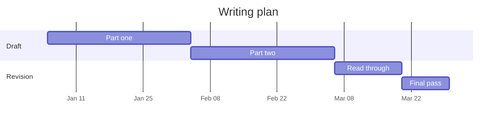
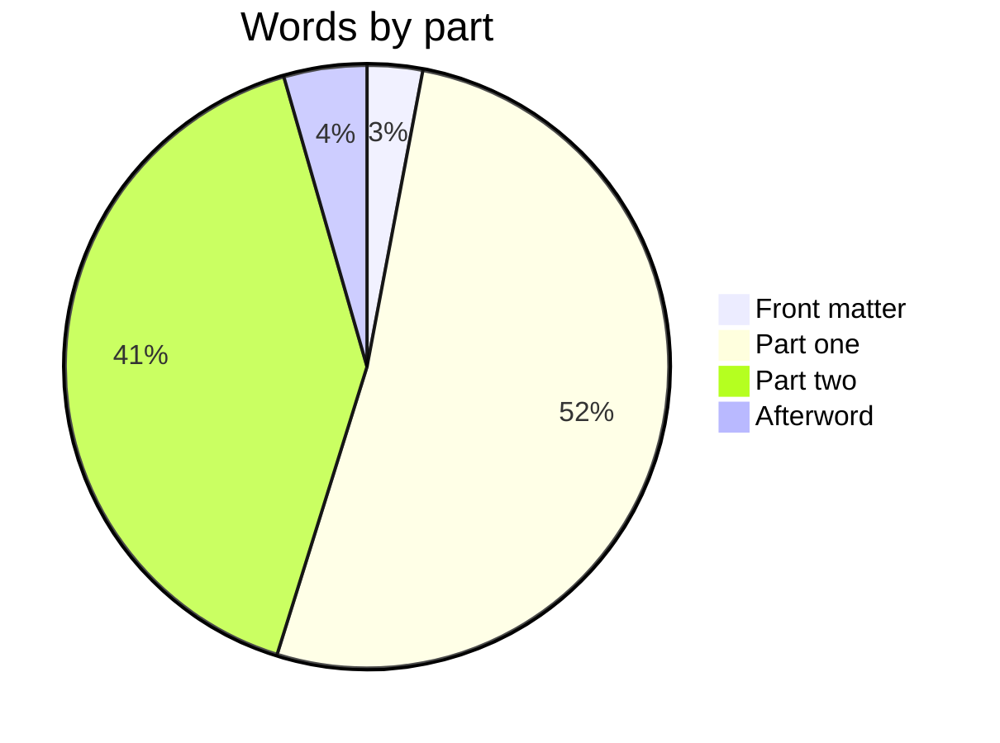

A Mermaid diagram is plain text in a `mermaid` code fence. Change the text and the drawing follows. Each kind of diagram starts with its own keyword.

A flowchart, with a loop back for another pass:

A sequence diagram shows who says what, in order:

A state diagram follows a text from first draft to print:

An entity-relationship diagram describes a small database. Here a book has many chapters, and each chapter has many comments:

A Gantt chart plans the writing:

A pie chart shows where the words went. The `{width=50%}` after `mermaid` sets its width on the page, as for a picture:

The [Mermaid documentation](https://mermaid.js.org) lists every kind of diagram and its syntax.
