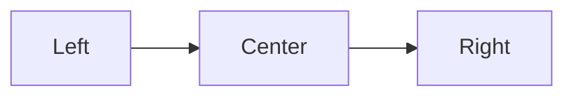

Text runs from the left margin unless you ask for something else. **Align Left**, **Center**, and **Align Right** wrap the paragraph at the cursor in a block that sets its side. Each block starts with `::: center`, `::: left`, or `::: right` and ends with `:::` on a line of its own.

::: center
*Chapter Seven*

The Lighthouse Keeper
:::

A dedication or an epigraph often sits on the right:

::: right
For the keepers of every light,

who watched the dark so we could sleep.
:::

The commands work on pictures too. Put the cursor on the picture's line and choose a side:

::: center
{width=30%}
:::

::: right
{width=20%}
:::

With the cursor anywhere inside a `mermaid` fence, the whole diagram moves as one piece:

::: center

:::

**Align Left** sets text back to the left inside a centered block, so a caption can be centered while the note under it is not:

::: center
{width=60%}

*The book folder*

::: left
The folder holds the manuscript, the pictures, and the comments, side by side.
:::
:::

The same blocks carry over to the printed book, the web page, and Word. In Word they become the paragraph styles Left Aligned, Centered, and Right Aligned, which you can change there.
